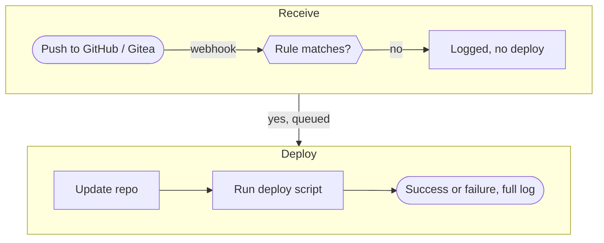

# degoploy user guide

degoploy runs your **deploy script** every time someone pushes to a GitHub or Gitea repository. You register a project, choose which pushes may deploy, write the script, and follow every deployment and its log live in the browser.

This guide covers **what you can do** in degoploy and **how to do it**. To install degoploy on a server, see [Installation](../INSTALL.md).

## How it works

## What's in this guide

**Getting started**
- [Signing in, invitations and roles](getting-started.md)

**Projects**
- [Creating a project and connecting the repository](projects.md)
- [Choosing when deploys run (trigger rules)](trigger-rules.md)
- [Writing the deploy script](deploy-script.md)
- [Variables and secrets](variables-and-secrets.md)
- [Runtimes: Node.js and PHP versions](runtimes.md)
- [Following and managing deployments](deployments.md)
- [Releases and rollback](releases.md)
- [Project settings](project-settings.md)

**Users & access**
- [Inviting and managing users](users-and-invites.md)
- [Roles and permissions](roles.md)
- [Sign-in methods and single sign-on](single-sign-on.md)
- [Audit log](audit-log.md)

**Configuration**
- [Email (SMTP) for invitations](email.md)

**Your account**
- [Password, theme and signing out](your-account.md)

## Roles at a glance

| Role | Can |
|---|---|
| **Viewer** | See projects, deployments and logs |
| **Deployer** | Everything a Viewer can, plus run, cancel, redeploy and roll back |
| **Admin** | Everything, including creating projects, editing scripts, rules and secrets, managing users, and sign-in settings |

The full list is in [Roles and permissions](roles.md).

## Glossary

| Term | Meaning |
|---|---|
| **Project** | One application degoploy deploys: its repository, a working directory on the server and a deploy script |
| **Deployment** | One run of the deploy script, with its status and log |
| **Trigger rule** | Decides which pushes (branch or tag, folders) start a deployment |
| **Webhook** | The notice GitHub or Gitea sends degoploy on every push |
| **Delivery** | One webhook degoploy received, logged with what happened to it |
| **Deploy key** | A project's own SSH key for reading a private repository |
| **Secret** | A variable kept encrypted, such as a database password |
| **Revision** | A saved version of the deploy script that you can go back to |
