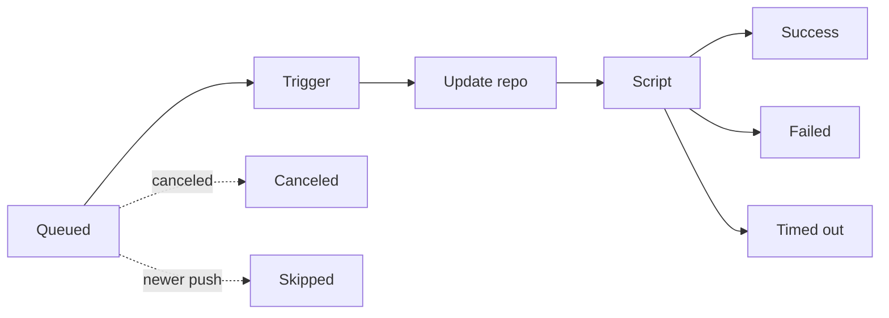

# Deployments

A deployment is one run of the deploy script. Each has a number, a status, its stages and a full log you can follow live.

Everyone can see deployments and their logs. **Deployers** and **admins** can also deploy manually, cancel, redeploy and roll back.

## Where deployments come from

| Trigger | When |
|---|---|
| **Webhook** | A push matches a [trigger rule](trigger-rules.md) |
| **Manual** | Someone clicks **Deploy now** |
| **Redeploy** | Someone runs an earlier deployment again |
| **Rollback** | Someone makes an earlier [release](releases.md) live again |

## The life of a deployment

- **Trigger**: the deployment is accepted and prepared.
- **Update repo**: the repository in the working directory is cloned the first time, or updated to the pushed commit.
- **Script**: the deploy script runs. With [releases](releases.md), `current` then switches to the new release. A [health check](releases.md#health-check), when set, runs at the end of this stage.

A rollback skips the first two: its last stage, **Switch release**, points `current` at the release.

### Statuses

| Status | Meaning |
|---|---|
| **Queued** | Waiting for its turn |
| **Running** | In progress |
| **Success** | The script finished without errors |
| **Failed** | The script or the repository update failed |
| **Timed out** | Ran past the project's timeout and was stopped |
| **Canceled** | Someone canceled it |
| **Skipped** | A newer push replaced it before it started |

### The queue

- Within a project, only **one** deployment runs at a time.
- If several pushes arrive while a deploy runs, only the **newest** one waits; older waiting ones are marked *Skipped*. An old version never deploys after a newer one.
- How many projects may deploy at once is a server setting.

## Deploy manually

1. On the project page, click **Deploy now**.
2. Choose **Branch** or **Tag** and enter its name.
3. Click **Deploy**.

degoploy deploys the latest commit of that branch or tag, with the **Extra environment** of the rule that matches it.

## Follow a deployment

Click a deployment anywhere in the app to open it:

- **Stages** with their durations.
- The **log**, streaming live while the deploy runs. Every line is timestamped, and the output of each command is grouped so it is easy to scan.
- **Run details**: what triggered it and who, the matched rule, the commit, the script revision and the working directory.
- **Environment**: the variables used. Secret values are never shown.
- Links to the previous and next deployment.
- The **⋯** menu: **View commit**, **Open on GitHub/Gitea** and **Download log**.

## Cancel a deployment

Click **Cancel** on a *Queued* or *Running* deployment and confirm. The script and every process it started are stopped, and the status becomes *Canceled*.

## Redeploy

Click **Redeploy** on a deployment. degoploy starts a new deployment of the **same commit**. Use it to:

- retry a deploy that failed for a passing reason, such as another server being down;
- roll back, by redeploying an older deployment that succeeded.

> [!NOTE]
> A redeploy runs the **current** deploy script, not the one the original deployment used.

> [!TIP]
> With [releases](releases.md) on, roll back from the **Releases** list instead: the older release is already built, so switching to it takes a second and runs no script.

## Good to know

- If the degoploy server restarts during a deploy, that deployment is marked *Failed* with the reason *interrupted*. Deployments still *Queued* run once the server is back.
- Secrets printed in the log show as `***`.
- Statuses across the app update on their own; the **Live** indicator in the header shows the live connection is up.
