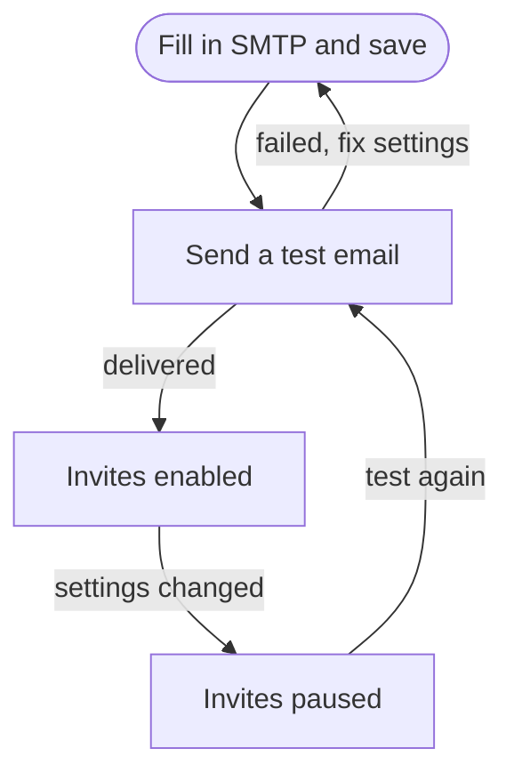

# Email (SMTP)

degoploy sends [invitations](users-and-invites.md#invite-people) by email. The **Email** page sets the SMTP server it sends them through.

Only **admins** can open it, from **Email** in the header.

## When invitations can go out

Inviting people unlocks after **two steps**:

Any change to the SMTP settings, the password included, **pauses** invitations until a new test email is delivered with the new settings. That way invitations are known to arrive.

| Status | Meaning |
|---|---|
| **Not set up · invites off** | Host, port or sender address is missing |
| **Not tested · invites paused** | Settings exist, but no test has been delivered with them |
| **Test failed · invites paused** | The latest test with these settings failed |
| **Verified · invites enabled** | A test was delivered; invitations go out |

## Fill in the SMTP server

| Field | What to enter |
|---|---|
| **Host** | The SMTP server, such as `smtp.example.com` |
| **Port** | Usually **587** (STARTTLS) or **465** (SSL/TLS). It follows your encryption choice |
| **Encryption** | **STARTTLS**, **SSL/TLS** or **None** |
| **Username** / **Password** | The SMTP login. Leave the username empty if the server needs none. The password is stored encrypted; click **Replace** to change it |
| **From name** / **From address** | The sender people see, such as *Degoploy &lt;no-reply@example.com&gt;* |

Click **Save**. As with single sign-on, changes apply at once and are saved to the config file. Fields set through the server's environment show as locked.

> [!WARNING]
> **None** sends the password unencrypted. Use it only for an SMTP server on your local network.

## Send a test email

1. Save the settings first; the test always uses the saved settings.
2. Under **Send a test email**, enter an address. It defaults to yours.
3. Click **Send test email**.

The result appears below it: **Delivered to …** with the server's reply (such as `250 OK`) and **Invites enabled**, or **Not delivered to …** with the reason, such as a refused login or an unreachable server.

## Troubleshooting

The test fails with a message about STARTTLS

The server does not offer STARTTLS on that port. Try **SSL/TLS** on port 465.

The test works, but invitations do not arrive

Check the recipient's spam folder. You can also copy the invitation link from the invite result and send it another way.

The link in the email points to the wrong address

Links use degoploy's public address (`base_url`). Without it, the address the admin's browser used is taken. Ask whoever runs the server to set `base_url`; see [Installation](../INSTALL.md).

