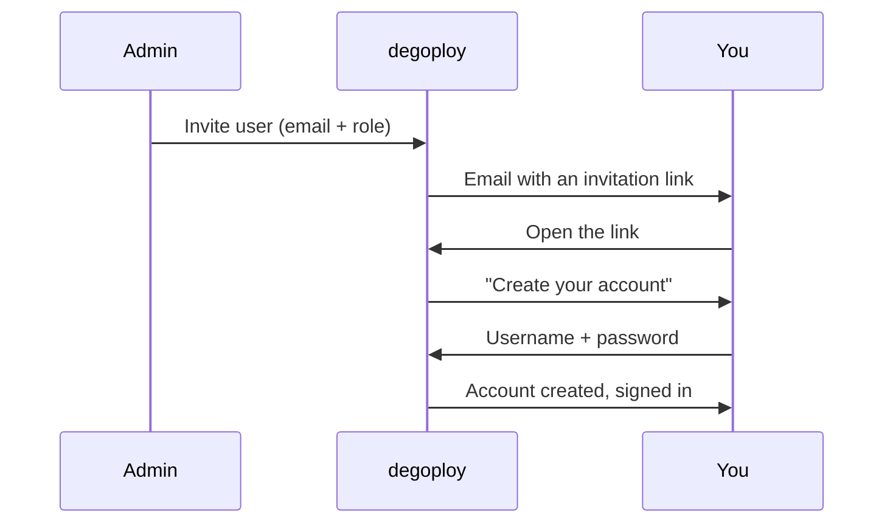

# Getting started

Sign in to degoploy, accept an invitation to create your account, and learn what your role lets you do.

## Sign in

Open degoploy in your browser. The **Sign in** page offers the methods your admin turned on:

- **Username and password**, for local accounts.
- **Continue with _(SSO name)_**, for your organization account through single sign-on (for example Casdoor). You are sent to the SSO sign-in page and come back signed in.

After signing in you land on **Projects**.

> [!NOTE]
> If single sign-on refuses you with *"Your account is not in a group that may use degoploy"*, your SSO account is not in a group degoploy allows yet. Ask an admin to add your group under [role mapping](single-sign-on.md#map-groups-to-roles).

## Accept an invitation

Admins can invite you by email:

1. Open the invitation email and click **Accept invitation** (or open the link in it).
2. On **Create your account**, your email and role are already filled in.
3. Enter a **Username** (letters, digits, dots, dashes or underscores), an optional **Display name**, and a **Password** of at least 10 characters.
4. Click **Create account**. You are signed in right away.

> [!IMPORTANT]
> An invitation link works **once** and expires after **7 days**. If yours has expired or was already used, ask an admin to resend it.

If you are signed in with another account in the same browser, creating the new account signs that one out.

## Choose a new password

When an admin resets your password and asks for a new one, you see **Choose a new password** right after signing in. The rest of degoploy stays closed until you pick one.

1. Enter **Password you were given**, the temporary password from the admin.
2. Enter a **New password** of at least 10 characters, different from the temporary one, and confirm it.
3. Click **Save and continue**.

## Know your role

Every account has one role: **Admin**, **Deployer** or **Viewer**. It decides which menus and buttons you see. A Viewer does not see **Deploy now**, for example, and only admins see **Users**, **Roles**, **Audit log**, **SSO** and **Email**.

See [Roles and permissions](roles.md) for the full list.
