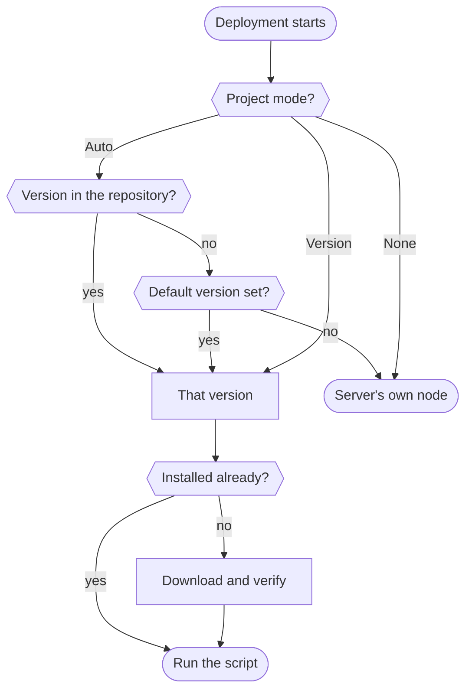

# Node.js versions

degoploy installs the Node.js version each project needs, the way nvm does on your own machine. Deploy scripts find `node`, `npm`, `npx`, `pnpm` and `yarn` on their PATH without loading nvm or changing the script.

Versions are downloaded from nodejs.org the first time a deployment needs them, checked against the release's SHA256 sums, and kept on the server for the next deployments. Admins manage them on the **Node.js** page.

## Choose the version for a project

Open the project's **Settings** and find the **Node.js** card. Pick one of three modes and click **Save**.

| Mode | What the script gets |
|---|---|
| **Auto** (default) | The version the repository asks for in `.nvmrc`, `.node-version`, `volta.node` or `engines.node` in `package.json`, checked in that order. Without one, the [default version](#the-default-version). |
| **Version** | The version you type, such as `22`, `20.11.1`, `>=20` or `lts`. |
| **None** | Nothing from degoploy: scripts use whatever `node` the server has. |

The card's footer shows which version the latest deployment ran with.

> [!TIP]
> If you already use nvm, keep your `.nvmrc` file. Auto reads it the same way, including aliases such as `lts/*` and `lts/iron`.

## How a version is picked



- A version that is **already installed** wins when it fits. `22` uses the newest installed 22.x and does not download a newer patch on its own; use **Update all** for that.
- When nothing installed fits, degoploy downloads the newest matching release, preferring LTS releases. A range like `>=18` therefore installs the newest LTS line, not a brand-new current release.
- The download shows in the deployment log under **Installing Node.js**, with its progress every 10%, followed by a `node:` line that names the version and where it came from, such as `node: v22.12.0 (22 from .nvmrc)`. The **Node.js** page shows the same download with a progress bar.

If no release matches, for example a typo such as `2.2` in `.nvmrc`, the deployment fails with the reason in its summary.

## pnpm and yarn

degoploy turns on corepack for each version it installs. If `package.json` has a `packageManager` field, such as `"packageManager": "pnpm@9.15.0"`, the script gets exactly that pnpm or yarn. Node.js 25 and later no longer ship corepack, so degoploy installs it from npm for those versions.

Packages installed with `npm install -g` belong to that one Node.js version, the same as with nvm.

## The Node.js page

Admins open **Node.js** in the top navigation.

- **Installed versions** lists each version, which projects deployed with it, its size and when it was installed.
- **Make default** sets that version's major line, such as `22`, as the default.
- The **trash** button removes a version. A project that still asks for it installs it again on its next deployment.
- **Update all** installs the latest patch of every installed line and removes the older one, for example 22.11.0 → 22.12.0. A version that a project asks for exactly, such as `22.11.0`, is kept.
- **Install a version** offers the current and LTS lines, or any version you type.

### The default version

The default is for projects on **Auto** whose repository names no version. Without a default, those scripts use the server's own `node`, if it has one.

## From the command line

On the server, members of the degoploy group can do the same without the browser:

```bash
degoploy node                  # list installed versions
degoploy node install 22       # or lts, 20.11.1
degoploy node default 22       # "none" clears it
degoploy node remove v20.19.0
degoploy node update           # latest patch of each installed line
```

## Good to know

- Versions live in the server's data directory under `node/`. Backups leave them out; they are downloaded again when needed.
- Each version takes roughly 150–200 MB on disk.
- The server needs to reach nodejs.org. Servers without internet access can use a mirror with the same layout; see `node_mirror` in [Installation](../INSTALL.md).
