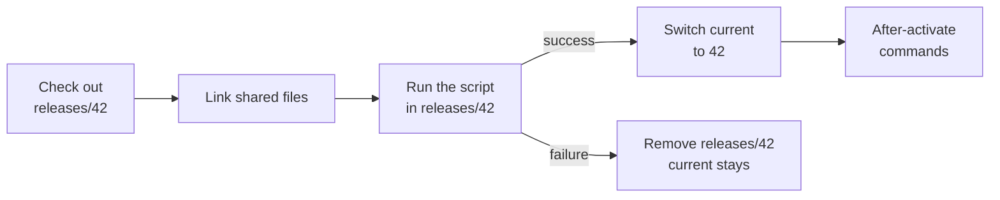

# Releases and rollback

With releases on, every deployment builds in a folder of its own and the site switches to it only when the deploy script succeeds. Visitors never see a half-built release, a failed build changes nothing, and an earlier release is live again in a second.

Without releases, degoploy updates one checkout in place: while `composer install` or `npm run build` runs, the site serves a mix of old and new files, and a failed build leaves it that way.

## How it works

The working directory holds the releases, not the code itself:

```text
/srv/degoploy/shop/
├── current → releases/42      the live release; point the web server here
├── releases/
│   ├── 42/                    deployment #42, live
│   └── 40/                    deployment #40, kept for rollback
├── shared/                    .env, storage/ and uploads, linked into every release
└── repo/                      fetched commits, shared by the releases
```



1. degoploy checks out the pushed commit into `releases/<deployment number>`.
2. Every **shared path** in the release becomes a link into `shared/`.
3. The deploy script runs **in the release**, not in `current`.
4. When the script succeeds, `current` switches to the new release in one step.
5. The **after-activate commands** run, then releases beyond the number to keep are removed.

If the script fails, times out or is canceled, the release is removed and `current` keeps pointing at the release that was live.

## Turn releases on

> [!IMPORTANT]
> Releases need an empty working directory: the folder of a project that deployed in place holds its checkout. Pick a new folder, or leave Working Directory empty on a new project.

1. In the project's **Settings**, under **Releases**, switch it on. For a new project, turn on **Deploy in releases** in the form.
2. Fill in **Shared paths** and the **After-activate commands** (below) and click **Save**.
3. Deploy once, then point the web server at `current`:

```nginx
root /srv/degoploy/shop/current/public;
```

**Update repository before running** stays on with releases: each release is a fresh checkout.

## Shared paths

Files that must outlive a release: the `.env`, uploaded files, logs and sessions. List them one per line, relative to the repository. End a folder with `/`.

```text
.env
storage/
public/uploads/
```

For each path:

- The first release that has it **moves** its copy into `shared/`. A repository with a `storage/` folder seeds `shared/storage/` that way.
- When no release has it, degoploy creates it empty: a folder for a path ending in `/`, a file otherwise. Fill in an empty `shared/.env` on the server.
- Every release then gets a link to `shared/` in its place, replacing what the commit had.

## After-activate commands

Commands that run with bash in `current` after every switch, rollbacks included. Use them for what must happen once the new code is live:

```bash
sudo systemctl reload php8.3-fpm
```

```bash
pm2 reload ecosystem.config.js
```

They get the same variables as the deploy script. If they fail, the deployment is marked *Failed*, but the release stays live: `current` has already switched.

> [!TIP]
> Reload PHP-FPM after a switch: OPcache keeps serving the old release's files otherwise.

## Roll back

Under **Releases** on the project page, every release still on the server is listed, the live one marked **Live**.

1. Click **Roll back** on an older release (or **Switch** on a newer one).
2. Confirm.

degoploy queues a deployment with the trigger *Rollback*. It runs no script: it switches `current` and runs the after-activate commands, so it takes a second. It appears in the deployment history like any other, and **Redeploy** on it switches to the same release again.

> [!WARNING]
> A rollback switches the code, not the data. Database migrations the newer release ran stay applied; roll them back yourself if the older code cannot work with them.

## How many releases are kept

**Releases to keep** counts the live one, 5 by default. After each switch, older releases beyond that are removed. A release the web server wrote files into may not be removable; the log says so.

## Variables for releases

Besides the [usual variables](deploy-script.md#variables-available-to-the-script), scripts and after-activate commands get:

| Variable | Value |
|---|---|
| `DEPLOY_RELEASE` | The release number: the deployment that built it |
| `DEPLOY_RELEASE_DIR` | Its folder, `releases/<number>` |
| `DEPLOY_SHARED_DIR` | The `shared/` folder |
| `DEPLOY_CURRENT_DIR` | The `current` link |
| `DEPLOY_WORKDIR` | Where the script runs: the release being built, or `current` for the after-activate commands |
