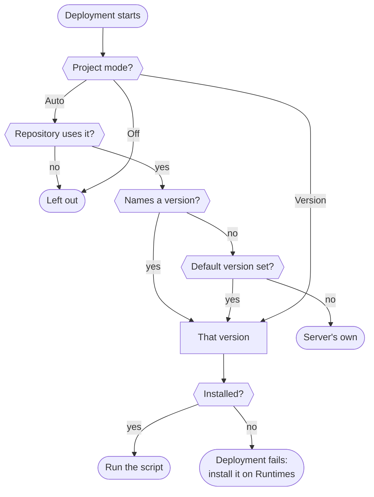

# Runtimes (Node.js and PHP)

degoploy installs the Node.js and PHP versions each project needs, the way nvm and phpenv do on your own machine. Deploy scripts find `node`, `npm`, `npx`, `pnpm`, `yarn`, `php` and `composer` on their PATH without loading anything or changing the script.

Each runtime is separate: a project turns on only the ones it uses, so a Laravel API without a frontend never gets Node.js, and a React site never gets PHP. Admins manage each runtime's versions on its own page under **Runtimes**.

> [!IMPORTANT]
> Versions are installed **only** on the [Runtimes page](#the-runtimes-page) or with the [CLI](#from-the-command-line). Projects pick among the installed versions, and deployments never download one: a deployment that needs a version the server does not have fails and says which one to install. Two projects or deployments therefore never wait for, or race over, the same download.

## Choose the runtimes for a project

Open the project's **Settings** and find the **Runtimes** card. Each runtime has three modes; click **Save** when done.

| Mode | What the script gets |
|---|---|
| **Auto** (default) | The runtime only when the repository uses it, with the version it names. Without a named version, the [default version](#the-default-version). |
| **Version** | Always this version, picked among the installed ones: a line such as `22` or `8.3` (its newest installed release), an exact one such as `20.11.1`, or a range such as `>=20`. |
| **Off** | Nothing from degoploy: scripts use whatever the server has. |

Next to each runtime, the card shows which version the latest deployment ran with.

In **Version** mode the quick picks are the lines installed on this server. A version that is not installed cannot be saved: the card says so and links to the runtime's page, where you install it first. With no version installed yet, the card shows only that link. If a version a project already uses is removed later, the card and the project's script page mark it **Not installed** until it is installed again or another one is picked.

**What Auto reads from the repository**, in this order:

| Runtime | Files |
|---|---|
| Node.js | `.nvmrc`, `.node-version`, `volta.node` and `engines.node` in `package.json`; a `package.json` alone turns it on |
| PHP | `.php-version`, `config.platform.php` and `require.php` in `composer.json`; a `composer.json` alone turns it on |

> [!TIP]
> If you already use nvm or phpenv, keep your `.nvmrc` or `.php-version` file. Auto reads them the same way, including aliases such as `lts/*` and `lts/iron`.

`config.platform.php` is read as its release line: `8.2.0` means any PHP 8.2, so the server's own 8.2 from apt or ondrej's PPA is used. Composer keeps resolving dependencies for the exact version written there.

## How a version is picked



- Only **installed** versions are used. `22` takes the newest installed 22.x and never a newer patch on its own; use **Update all** on the Runtimes page for that. A version the **system** installed (see below) wins over one degoploy downloaded. `lts` and `lts/iron` match installed LTS versions.
- The deployment log names the version and where the spec came from, such as `php: 8.3.14 (^8.2 from composer.json require.php)`.

If no installed version fits, for example when `.nvmrc` asks for `lts/iron` and no Node.js 20 is installed, or for a typo such as `2.2`, the deployment fails before the script runs: *Node.js lts/iron (from .nvmrc) is not installed on this server; an admin can install it on the Runtimes page*. Install it there and redeploy.

## Node.js

- Builds come from nodejs.org and are checked against the release's published SHA256 sums.
- degoploy turns on corepack for each version. If `package.json` has a `packageManager` field, such as `"packageManager": "pnpm@9.15.0"`, the script gets exactly that pnpm or yarn. Node.js 25 and later no longer ship corepack, so degoploy installs it from npm.
- Packages installed with `npm install -g` belong to that one version, the same as with nvm.
- A Node.js installed by the system's package manager at `/usr/bin/node` is listed as a **System** version and used as it is.

## PHP

- **System versions come first.** PHP that the server already has, such as `php8.2` and `php8.3` from apt or ondrej's PPA, is listed as **System** and used as it is. These match the server's PHP-FPM and its extensions, which is what you want when the script runs `composer install` and `artisan migrate` for the site that FPM serves. degoploy never removes or updates them; use the system's package manager for that.
- **Other versions are downloaded** on the Runtimes page as ready-made static builds from static-php.dev, for PHP 8.2 to 8.5. They need no root and no compiling, and include a broad set of extensions: `bcmath`, `curl`, `gd`, `imagick`, `intl`, `mbstring`, `mysqli`, `pdo_mysql`, `pgsql`, `redis`, `sodium`, `zip` and more. Extensions outside that set cannot be added; install that PHP version on the system instead.
- static-php.dev publishes a SHA256 for its recent builds, which degoploy checks. Every download is also run once: it must start and report the expected version. Older patch builds have no published SHA256 and get only that second check.
- **Composer** is downloaded once from getcomposer.org, checked against its published SHA256, and available as `composer` with whichever PHP version the project uses.

> [!NOTE]
> The PHP that deploy scripts use does not change the PHP that serves your site. If the site runs on PHP-FPM, reload it from the script as before, for example `sudo systemctl reload php8.3-fpm`.

## The Runtimes page

Admins open **Runtimes** in the top navigation. The menu on the left lists the runtimes, each on its own page (**Node.js**, **PHP**); a runtime that is turned off is marked *Off* there. In a project's **Runtimes** card, **Manage versions** next to a runtime opens its page. Each page has:

- The **On/Off** switch turns a runtime off for every project on this server, whatever their settings say.
- The list shows each version, which projects deployed with it, and its size or, for system versions, where it lives.
- **Make default** sets that version's line, such as `22` or `8.3`, as the default.
- The **trash** button removes a downloaded version. A project that still asks for it fails its next deployment until the version is installed again. System versions have none.
- **Update all** installs the latest patch of every downloaded line and removes the older one, for example 8.3.12 → 8.3.14. A version that a project asks for exactly is kept.
- **Install a version** offers the newest lines, or any version you type. A download shows its progress and can be **canceled**, from the page or the CLI.

### The default version

The default is for projects on **Auto** whose repository uses a runtime without naming a version. Without a default, those scripts use the server's own `node` or `php`, if there is one.

## From the command line

On the server, members of the degoploy group can do the same without the browser:

```bash
degoploy node                  # list Node.js versions; degoploy php for PHP
degoploy php install 8.3       # or 8.3.14; node install 22, lts, 20.11.1
degoploy php default 8.3       # "none" clears it
degoploy node remove v20.19.0
degoploy php update            # latest patch of each downloaded line
degoploy node cancel           # stop a download; Ctrl+C during install does too
```

## Good to know

- Downloaded versions live under `node/` and `php/` in `runtimes_dir` (`/var/lib/degoploy-runtimes` on a standard install), where the user deploy scripts run as can read them. Backups leave them out; they are downloaded again when needed.
- A Node.js version takes roughly 150–200 MB on disk, a PHP version about 30 MB.
- The server needs to reach nodejs.org, static-php.dev and getcomposer.org. Servers without internet access can use mirrors with the same layout; see `node_mirror`, `php_mirror` and `composer_url` in [Installation](../INSTALL.md).
