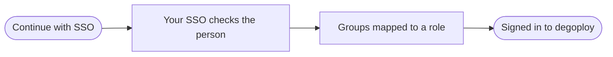

# Single sign-on

Let your team sign in to degoploy with their organization account through OpenID Connect, for example Casdoor. Their groups decide what they can do, and password sign-in can stay on as a fallback.

Only **admins** can change sign-in methods. Open **SSO** in the header.

## How sign-in works

## Before you start

- [ ] An SSO server (such as Casdoor) that the degoploy server can reach
- [ ] Permission to create an application in your SSO organization
- [ ] The groups your team uses in the SSO

> [!NOTE]
> Changes on this page are **saved to the degoploy config file and apply at once**, with no restart and no file editing. Fields set through the server's environment show as locked (*Set by … on the server*); change those on the server and restart.

## Set it up

1. **Create an application in your SSO.** Copy its **Client ID** and **Client secret**.
2. **Fill in the OIDC card:**

   | Field | What to enter |
   |---|---|
   | **Provider name** | The name on the button, so *Degovan SSO* becomes **Continue with Degovan SSO** |
   | **Issuer URL** | Your SSO address, such as `https://sso.example.com`. Click **Discover** to check it |
   | **Client ID** | From the SSO application |
   | **Client secret** | From the SSO application. Stored encrypted and never shown again; type a new value to replace it |
   | **Redirect URL** | degoploy's callback address. Click the suggestion under the field to fill it in, then add it to the SSO application's redirect URLs |
   | **Scopes** | What degoploy asks the SSO for. `openid` is always included; add or remove the rest |

3. **Map groups to roles.** SSO cannot be turned on without a mapping; see [below](#map-groups-to-roles).
4. **Turn on** the switch on the OIDC card and click **Save**.
5. **Click Test sign-in** to check it end to end.

### Check the issuer

After entering the **Issuer URL**, click **Discover** (or **Re-discover**). degoploy fetches the SSO's configuration and shows:

- *Discovery document found* with its endpoints, or why the address is wrong or unreachable;
- whether the SSO sends the `groups`, `email` and `name` claims (✓ or ✗);
- the scopes it supports, to guide **Scopes**.

The status on the OIDC card (**Connected**, **Unreachable** or **Off**) comes from this check.

### Test sign-in

After saving, **Test sign-in** runs a real SSO sign-in **without** replacing your session. Sign in with any SSO account; back in degoploy you see the outcome, such as *rina@example.com (groups degovan/devops) would sign in as viewer*, or why the account would be refused. No account is created by a test.

## Map groups to roles

Role mapping gives people who sign in with SSO a degoploy role based on their SSO **groups**.

1. **Groups claim**: the claim that lists groups, usually `groups`. Casdoor sends groups as `organization/group`.
2. Click **Add mapping**, enter a group and choose its role. Repeat for other groups.
3. The **Everyone else** row sets the role for people in none of those groups. Choose **Don't allow** to refuse them.
4. **Sync role on every sign-in**: when on, the role follows the groups on every sign-in, overwriting changes made on the Users page. When off, the role is set only when the account is first created.
5. Click **Save**.

Someone in several mapped groups gets the **highest** of their roles.

> [!TIP]
> Not sure of a group's exact name? **Recent SSO sign-ins** lists the last 20 SSO sign-ins and tests with the groups the SSO sent. Click a group to copy it, or open **Claims** to see everything the SSO sent.

## Password sign-in

The **Password** card turns username-and-password sign-in on or off, and shows how many users have a password and when one last signed in.

> [!WARNING]
> With password sign-in off, everyone, admins included, must use SSO. degoploy refuses to turn it off while no active admin signs in with SSO, so nobody gets locked out.

## Good to know

- SSO accounts are created automatically the first time someone signs in; they need no invitation.
- SSO accounts have no degoploy password; it is managed in the SSO.
- SSO accounts are matched by the SSO's identity, never by username or email, so an SSO account cannot take over a local account with the same name.
- Every change here is recorded in the [audit log](audit-log.md) as sensitive.

## Troubleshooting

People are refused with "not in a group that may use degoploy"

Their groups match no mapping and **Everyone else** is set to **Don't allow**. Check **Recent SSO sign-ins** for the groups the SSO sent, then add a mapping or set a role for everyone else.

Discovery fails or the card shows Unreachable

The degoploy server cannot reach the issuer, or the address is not the SSO's exact issuer. degoploy names the issuer the SSO reports for itself; use exactly that.

The SSO says the redirect URL is invalid

The **Redirect URL** must match one of the SSO application's redirect URLs exactly, including `https://` and the path `/auth/oidc/callback`.

Everyone gets the same role even though groups are mapped

The SSO may not send groups in the claim degoploy reads. Make sure **Groups claim** matches, and that the SSO includes groups in the token or user info.

