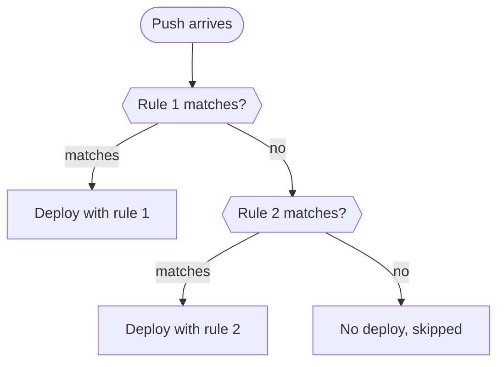

# Trigger rules

Trigger rules decide **which pushes start a deployment**. A push that matches no rule is still logged, but nothing deploys.

Everyone can see rules. Only **admins** can add, change, reorder and delete them. Find them on a project's **Triggers** tab.

## How rules match

Rules are checked **top to bottom**, and the first one that matches wins. A rule matches when **all** of these hold:

- [x] The rule is **Enabled**.
- [x] The push is the right kind: **Branch** or **Tag**.
- [x] The branch or tag name matches the pattern.
- [x] The commit message does **not** contain the skip keyword.
- [x] If path filters are set, at least one changed file passes them.

## Add a rule

1. On the **Triggers** tab, click **Add Rule**.
2. Fill in the rule:

   | Field | What it does |
   |---|---|
   | **Name** | A label, for example `Production` |
   | **Branch / Tag** | Which kind of push the rule listens for |
   | **Branch pattern** / **Tag pattern** | One or more comma-separated patterns, such as `main, release/*` or `v*` |
   | **Only when these paths change** | Optional. Deploy only if a changed file matches, one pattern per line, such as `src/**` |
   | **Ignore changes to** | Optional. Changes here do not count, such as `*.md` or `docs/**` |
   | **Skip when commit message contains** | A keyword that cancels the deploy. Defaults to `[skip deploy]` |
   | **Extra environment** | Optional. Extra variables for the script, one `KEY=value` per line, such as `APP_ENV=production` |
   | **Enabled** | Turn off to pause the rule without deleting it |

3. Click **Create Rule**.

### Pattern syntax

| Pattern | Matches |
|---|---|
| `*` | Anything **within one segment** (not `/`). `release/*` matches `release/1.2` but not `release/1/2` |
| `**` | Anything, **including** `/`. `src/**` matches every file under `src` |
| `?` | One character |
| A path pattern without `/` | That file name in any folder. `*.md` matches `docs/readme.md` |

## Change, reorder and delete

- Click the pencil on a rule to edit it, then **Save Changes**.
- Drag the handle on the left of a row, or use the arrow keys on it, to reorder. Order decides which rule wins when several match.
- The switch on each row turns a rule on or off.
- The **⋯** menu has **Move up**, **Move down** and **Delete**.

Each rule shows when it last matched (*Last matched …*) with a link to the deployment it started.

## Try a push without pushing

The **Test a Push** panel next to the rules simulates a push:

1. Choose **Branch** or **Tag** and enter its name.
2. Optionally add a **Commit message** and **Changed files**, one per line.
3. Click **Run test**.

You see which rule would deploy and why the others did not, for example *"main" does not match release/\** or *commit message contains "[skip deploy]"*.

## Good to know

> [!NOTE]
> When GitHub or Gitea does not list the changed files (a new branch or a force push, for example), path filters are **skipped** and the rule counts as a match, so a deploy is never missed.

- A rule's **Extra environment** overrides project variables with the same name.
- **Deploy now** also uses the extra environment of the rule that matches the chosen branch or tag.
